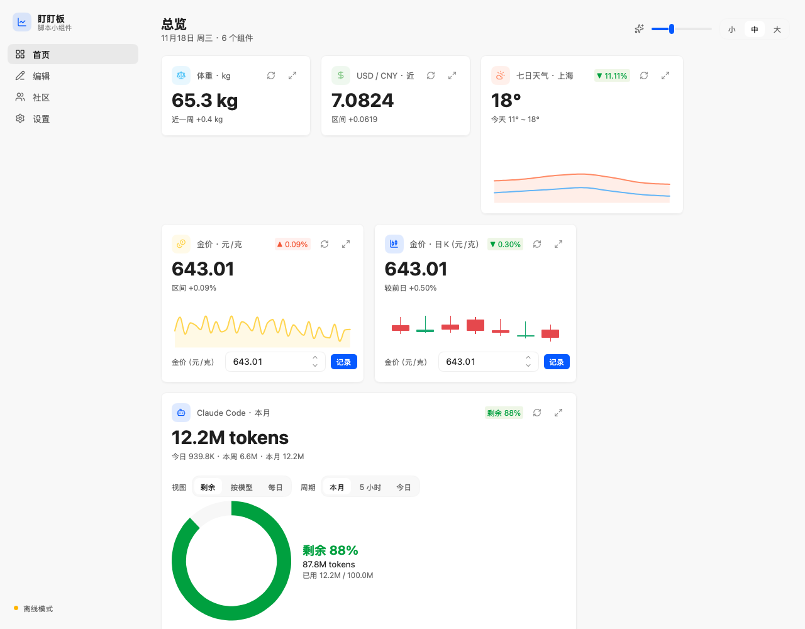
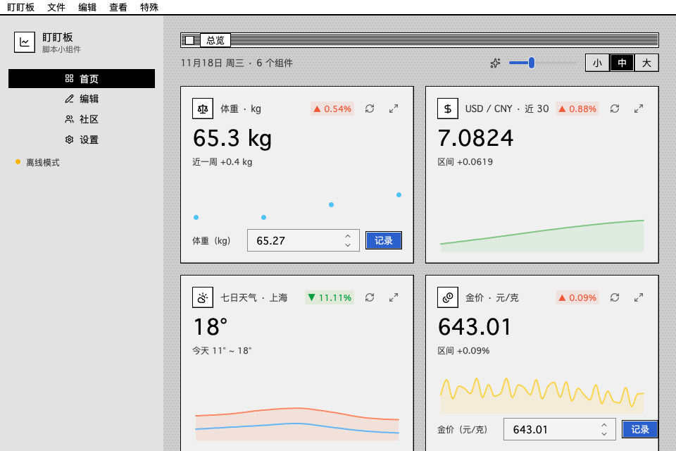

# 盯盯板 · ScriptBoard

[](https://github.com/mcxen/ScriptBoard/actions/workflows/ci.yml)
[](https://github.com/mcxen/ScriptBoard/releases/latest)

中文名「盯盯板」，英文名 ScriptBoard。用 MyGo（界面）和 moejs（脚本）做的应用，有桌面版，也有安卓版的排版。脚本决定显示什么，图表、图标、全屏查看由应用负责。



## 下载与安装

从 [Releases](https://github.com/mcxen/ScriptBoard/releases/latest) 下载：

| 平台 | 文件 |
| --- | --- |
| macOS（Apple 芯片与 Intel） | `scriptboard-<版本>.dmg` |
| Windows | `scriptboard-setup-<版本>-amd64.exe`、`…-arm64.exe` |
| Linux | `scriptboard_<版本>_amd64.deb`、`…_arm64.deb`，或 `.tar.gz`（解压到可写的目录，能自己更新） |
| Android | `scriptboard-<版本>.apk`（调试密钥签名，手动安装，不会自动更新） |

- macOS 的应用是临时签名（ad hoc），没有公证：拖进「应用程序」后第一次用右键 › 打开，或运行 `xattr -dr com.apple.quarantine /Applications/ScriptBoard.app`。
- Windows 的安装包没有代码签名，SmartScreen 会提示：更多信息 › 仍要运行。
- **GitHub 下载慢或打不开**：每个版本的发布说明末尾有「Mirror downloads」，是同一批文件的 [tvv.tw](https://tvv.tw) 镜像链接（在原地址前加 `https://tvv.tw/`）。

## 自动更新与镜像

应用自己检查更新（设置 → 更新）：启动后约 10 秒看一次，之后每天一次，有新版本时显示更新说明，可以安装、稍后提醒或跳过这一版；装完提示重启。

- **签名**：每个平台的更新包都用发布者的 Ed25519 私钥签名，应用内置公钥（`mygo.json` 的 `updates.publicKey`，也写在 `update.go`，测试会检查两处一致），签名不对的文件不会安装。私钥只放在 GitHub 的 Secrets（`MYGO_UPDATER_PRIVATE_KEY`）和发布者自己的保险处，不在仓库里。
- **来源**（设置 → 更新 → 更新来源）：**自动**（系统语言是中文时走 tvv.tw 镜像，否则走 GitHub）、**GitHub**、**tvv.tw 镜像**。镜像只是代理：清单和更新包先从镜像取，超时、下载失败、大小不对或签名不对时自动改用 GitHub，所以镜像不可信也无妨。
- **不能自己更新的情况**：开发版，或用包管理器安装的版本（比如装在 `/opt` 的 `.deb`）：下载新版安装包覆盖即可。
- 自己的更新服务器或 S3/R2：`mygo.json` 的 `updates` 可以改用 `url` 或 `s3`，见 [MyGo 的 auto-updates 文档](https://github.com/egoist/mygo/blob/main/docs/updates.md)。

## 发布（给维护者）

发布流程和 Notes 应用一样：打一个 `v<版本>` 的标签，GitHub Actions 构建所有平台、签名更新并发布。

1. 改 `mygo.json` 的 `version`，在 `CHANGELOG.md` 加 `## <版本>` 一节（它就是更新说明）。
2. 一次性：`go tool mygo keygen -o <目录>` 生成密钥对，公钥写进 `mygo.json`，私钥存进仓库的 Secrets：`gh secret set MYGO_UPDATER_PRIVATE_KEY < <目录>/mygo-update.key`。**私钥丢了，已安装的应用就收不到更新。**
3. `git tag v0.1.0 && git push origin v0.1.0`。
4. `.github/workflows/release.yml`：测试 → 建草稿发布 → 在 macOS（universal）、Windows（amd64、arm64）、Linux（amd64、arm64）上 `mygo build -sign - -upload` → 检查每个平台的安装包和 `update-*.json` 清单都在 → 公开发布 → 在发布说明末尾加 tvv.tw 镜像链接。Android 的 APK 另起一个任务，失败不影响桌面版。
5. 本地构建：`go tool mygo build`（当前平台）、`go tool mygo build -platform android`。


## 行情：数字跳动与悬浮详情

- **数字会跳动**：卡片上的数字和全屏页的大数字，变化时会在 0.35 秒内缓动到新值（单位和小数位保持不变），缓动期间自动重绘。
- **悬浮定位**：全屏的 K 线或折线，鼠标移到哪里，大数字就变成那一点的值，标题下面显示那一根的日期和开、高、低、收（或各条线的值）；十字线和坐标标签仍然显示。
- 面积图是从线条向下渐变的，最新值处有一条虚线。

示例脚本在 `docs/examples/`：`retention-heat.js`（热力表）和 `price-panels.js`（价格面板），可以在「编辑 → 导入」里粘贴使用。

## 外观与复古图表

「设置 → 外观」在「默认」和「Mac OS 9」之间切换，所有页面立即换成所选的外观（保存在设置里）。

- **默认**：Lobe 的令牌，蓝色主色，圆角。
- **Mac OS 9**：整套控件都换成了经典 Mac 的样子，由应用自己画：菜单栏、带横纹的窗口标题栏、有立体边的按钮和分段选项、方形的复选框、反白选中的侧栏、带点阵的桌面、白底的图表区，字体优先用 Geneva（没有 Geneva 的系统用系统字体）。浅色外观，深色系统下也保持浅色。窗口本身仍是系统的窗口，只是内容换了样子。

图表样式里有三种复古样式，**任何皮肤下都能用**，在全屏查看的「样式」里选：

- **条纹柱**：柱子上有浅色的横纹。
- **像素点**：每个数据点是一个小方块。
- **网格折线**：折线背后有竖向的网格线。



## 中文与英文

「设置 → 语言」可选自动、中文、English；自动时跟随系统（环境变量 `SCRIPTBOARD_LANG`、`LC_ALL`、`LANG`，再读 macOS 的语言设置）。切换后界面、内置脚本的标题与维度、窗口标题和应用名（盯盯板 / ScriptBoard）立即换成对应语言。

- 界面文字在源码里写中文，`tr("…")` 在 `i18n_en.go` 的表里查英文；表里没有的字符串原样显示，不会空白。来自 `internal/` 的错误信息用 `trMsg` 翻译（`i18n_msg.go`）。
- 脚本拿到语言：`meta({lang})` 的参数和 `render(ctx).lang` 都是 `"zh"` 或 `"en"`，自己写的脚本可以据此出中英文标题（内置脚本的写法是 `t("中文", "English")`）。
- 加语言：给 `enText` 补一张表，`tr` 里按语言选表即可；`i18n_test.go` 会检查英文界面里没有漏掉的中文。

## 界面与组件

界面用 [Lobe MyGo](https://mygo.lobehub.com)（`github.com/lobehub/lobe-mygo`）的组件和设计令牌，图表和图标是自己的。Lobe 的组件都是 `组件(c, 值, Props{…})` 的形式，`Props` 里的零值就是默认值。`kit.go` 把它们包成 `btn`、`primaryBtn`、`segmented`、`sw`、`textInput`、`numberInput` 等，页面里直接调用；卡片是 `layout.Block`，涨跌标签是 `display.Tag`，空状态是 `display.Empty`，侧栏和编辑页的脚本列表是 `display.List`。

图表也是同一种形式：

```go
Chart(c, ChartProps{
    Data:     res.Chart,        // 脚本给的数据（line / dot / candle）
    Style:    "area",           // 样式，空则用数据自己的
    Height:   320,
    Selected: sel,              // 悬浮选中的点，nil 则不可选
    Full:     true,             // 全屏：横轴多个标签 + 十字线坐标
})
```

图表的数据、类型、标签都来自脚本的 `render` 返回值；样式和维度在卡片或全屏页上选；设置页只放全局的东西（体重单位、离线模式、社区地址等）。

## 页面

- **首页**：组件卡片，每张卡片是一个脚本的输出。卡片可以**大小不一**：顶部的 小 / 中 / 大 一次设置全部，每张卡片右上角的按钮或右键菜单单独设置这一张；滑条整体缩放图标与卡片（70% 到 160%）。
- **编辑布局**：顶部的「编辑布局」打开编辑模式。拖卡片的正文可以换位置；拖卡片右下角的角可以调宽窄和高矮（宽度按列吸附，高度每 16 点一档）；「完成」退出。位置、大小和顺序都保存在设置里，「小 / 中 / 大」一次设置全部时会清掉手动排的位置。
- 网格是 12 列（窄于 900 点时 6 列，手机单列）。每一行的最后一张卡片会占满这一行剩下的列，所以窗口拉宽也不会右边空一大块。卡片右上角的刷新按钮立即重新取数（见下文「点击刷新」）。点卡片进入全屏查看（编辑模式里不进入）。
- **全屏查看**：一个脚本的完整视图，见下文「全屏与图表」。
- **编辑**：左边选脚本或数据表。脚本：中间改源码，右边看预览、调节维度，也可以导入、导出脚本；插件脚本在插件文件夹里改，编辑页只读。数据表：中间是表格，见下。两种东西不混在一起。

### 数据表

有的插件不需要脚本，就是一张表：**设置 → 编辑 → + 数据表**。表格可以直接改单元格、加删行列、按时间排序（40 行一页）；**导入 Excel / CSV**（`.xlsx`、`.csv`、`.tsv`，中文系统的 GBK 编码的 CSV 也能读；手机上用「粘贴导入」），或从 Excel 复制一块单元格**粘贴导入**；导入时可选「替换」或「追加」；**导出 CSV**（带 BOM，Excel 直接打开不乱码）或「复制 CSV」。表里的数字自动成为图表的曲线，第一列是日期或文字时当横轴标签，设为「显示在首页」就是一张卡片。

内置的「体重数据」「金价数据」是已记录数值的表：改这里就是改首页卡片用的记录（体重按设置里的单位显示，保存时换回公斤），导入时按时间合并。数据表不能上传到社区。
- **社区**：登录后上传脚本，等管理员审核；无需登录即可下载已通过的脚本。
- **设置**：体重单位、离线模式、提醒时间（只保存，未接通知）、数据源（「管理数据源」）、社区地址、插件目录、首页卡片开关。

窗口宽度小于 640 时改用手机排版：底部标签栏，卡片和表单单列排列。

## 全屏与图表

点击任一卡片进入全屏查看，可以看到：

- **样式**：折线、面积、点状、柱状、阶梯；K 线数据另有 K 线、收盘线、收盘柱。选择的样式会同时用于首页卡片。
- **大图**：打开后图表占满窗口高度。
- **坐标**：鼠标移到图上，显示最近一点的标签和数值，并在右侧显示鼠标所在高度的数值（十字线）。
- **统计**：最新、涨跌（含自起点的百分比）、最高、最低、平均、振幅，每项都标出对应的日期或时间。
- **维度**：脚本声明的维度（如范围、周期）都可以切换。
- **关于**：来源（内置脚本或本地插件）、图标、可调维度、数据来源。

图表的数据类型由脚本决定：

| `type` | 画什么 | 数据 |
| --- | --- | --- |
| `line`（默认） | 折线 / 面积 / 点状 / 柱状 / 阶梯 | `series: [{name, color, points}]`，`labels` |
| `dot` | 点状 | 同上 |
| `candle` | K 线 / 空心K线 / 美国线 / 收盘线 / 收盘柱 | 两种给法：`candles: [{o,h,l,c}]` + `labels`；或者只给 `ticks: [{t,v}]`（按时间排好），再给 `period`（秒；`-1` 为日历月），宿主按周期聚合，`limit` 只保留最后几根 |
| `gauge` | **剩余量**圆环：中间是剩余百分比，旁边是剩余、已用 / 上限、重置时间；剩余 ≤30% 变琥珀色，≤10% 变红色 | `gauge: {used, limit, unit, label, reset}` |
| `barh` | **横置条形图**：每项一行，按大小排序，标签在左、数值在右 | `series[0].points` 与 `labels` |
| `heat` | **热力表**：一张表，每格是 0–100 的数字，颜色随数字加深（留存矩阵、活跃日历）。点一格选中它，底部显示那一格的详情。`grid: {columns, rows: [{label, note, cells}], average, footer}`，空格写 `-1` | `grid` |
| `panels` | **面板叠放**：价格和指标各占一块，共用一根时间轴，悬浮时十字线同时出现在每个面板上。参考线是虚线的常数序列 | `panels: [{title, style, weight, series}]` |
| `combo` | **曲线加圆环**：左边是曲线，右边是一排圆环，每个圆环是百分之几，下面写名字。曲线可以只占一段（`offset`）并画成虚线（`dashed: true`），适合「已有的 + 预计的」 | `series`（每条可以带 `offset`、`dashed`），`rings: [{label, percent, text?, color?}]` |

K 线的周期由宿主统一聚合（`internal/engine/candles.go`）：秒、分、时、日、周（周一开始）、月（日历月），时间按本地时区划分。内置的「金价 K 线」脚本就是这样，周期维度选 日、周、月、时、分、秒。

多条折线时只给第一条填充面积，避免两层半透明色叠出不属于任何一条线的颜色。

## 点击刷新

每张卡片和全屏页都有刷新按钮：立即轮询这个脚本读取的数据源（`meta.feeds`，包括 curl、tcp、文件等），清掉缓存的 AI 用量，再重新运行脚本，脚本自己的 `meta.sources`（比如你自定义的接口地址）也会重新请求。离线模式下不发请求，只用已存的数据重新运行。刷新期间按钮保持按下状态，同一张卡片不会同时刷新两次。

## 插件（本地开发，不需要登录）

插件是电脑上的一个文件夹，应用启动时加载，之后每秒检查一次，有改动就自动更新：

```
<数据目录>/plugins/<插件 id>/plugin.json
<数据目录>/plugins/<插件 id>/script.js
<数据目录>/plugins/<插件 id>/icons/<图标名>.svg     （可选）
<数据目录>/icons/<图标名>.svg                       （可选，共用的图标）
```

`plugin.json` 示例：

```json
{ "id": "local-weather", "name": "本地天气", "icon": "cloud-sun", "description": "演示插件", "home": true }
```

插件不经过登录和审核，文件夹就是插件的全部。插件的脚本在编辑页只读，要改就改文件夹里的 `script.js`。

数据目录：macOS 为 `~/Library/Application Support/ScriptBoard/`，可以用环境变量 `SCRIPTBOARD_DATA` 指定。

## 数据源：多协议取数，按小时或按天画曲线

在「设置 → 数据源」里添加一个数据源，应用每隔 1 分钟（或 5 分钟、1 小时）请求一次，把响应里的数字存下来。

- **协议**：`https://` / `http://`（也可以直接粘贴 curl 命令）、`tcp://主机:端口`（连上后发送下面几行内容，读到对方关闭或停止发送）、`file:///绝对路径`（每次整个读取一个本地文件）、`exec:程序 参数…`（运行程序读它的输出；不经过 shell，**默认关闭**，要在设置里打开「允许 exec 协议」）。`feed.Register(Protocol)` 可以再加协议（websocket、串口、消息队列……），不用改别的代码。
- **curl**：支持 `-X`、`-H`、`-b`（cookie，如 `-b 'session=abc'`）、`-d` / `--data-raw`、`-u`、`-A`、`-e`。读取本地文件的参数（`-d @file`、`-b cookies.txt`）和无法复现的参数会被拒绝，并说明原因。
- **取数**：JSON 路径（`data.price`；`data.items.#.v` 取数组里每一项，一次得到多个数字），或正则（第一个分组是数字）。
- **汇总**：每个数据点一个值，按小时或按天汇总时取最新、平均、最大或最小。
- **脚本使用**：脚本在 `meta()` 里声明 `feeds: ["id"]`，`render` 通过 `ctx.feeds.id` 拿到 `hour` 与 `day` 两组数据（每组有 `labels`、`series`、`counts`），还有 `latest`、`latestAt`、`error`、`stale`（数据已旧或上次失败）和 `fails`（连续失败次数）。

```js
export function meta() {
  return {
    name: "实时金价",
    feeds: ["gold-live"],
    dims: [{ key: "bucket", label: "粒度", options: [{ value: 1, label: "小时" }, { value: 24, label: "天" }] }],
    sources: {},
  };
}
export function render(ctx) {
  const f = ctx.feeds["gold-live"];
  const b = ctx.view.bucket === 24 ? f.day : f.hour;
  return { title: "金价" + (f.stale ? "（旧数据）" : ""), big: f.latest[0].toFixed(2), sub: "", lines: [],
           chart: { type: "line", series: b.series, labels: b.labels } };
}
```

### 高可用

数据源在别人的服务器上，总会有出问题的时候，所以：

- **重试**：超时、连接重置、5xx、429、408 会重试（默认再试 2 次，等待 0.5 秒、1 秒……逐次翻倍，上限 8 秒，每次随机缩短最多一半，免得多个数据源一起重试）；4xx、地址错误、取不到数字这类重试也没用的错误不重试。每次请求有自己的超时（默认 10 秒）。`Source.Timeout`、`Source.Retries` 可调。
- **备用请求**：`Source.Fallbacks`（添加表单里的「备用请求」，多个之间空一行）。主请求失败，或响应里取不到数字时，依次试备用请求，规则相同；卡片上会写明是由第几个备用请求提供的。
- **熔断**：连续失败 3 次后停止按正常节奏请求，间隔逐次翻倍，最长 1 小时，并带最多 10% 的随机抖动；一次成功就恢复。你点「立即获取」或卡片上的刷新按钮总是会试。
- **保留最后一次成功的数据**：失败不会清掉已存的样本；脚本看到 `stale: true`。
- **不重复、不拖累**：同一个数据源同一时间只会有一次请求在进行；到期的数据源最多 4 个并行，一个慢的接口不会拖住其他的。
- **健康状态**：数据源页每张卡片显示 正常 / 重试中 / 已暂停、连续失败次数、下次尝试时间、使用的协议、备用请求个数和上一次的错误。

**抽象与接口**（`internal/feed`）：

```
Request   {method, url, headers, cookies, body}         ← ParseRequest(curl 命令或任一协议的地址)
Protocol  interface { Fetcher; Scheme(); Validate(Request) }   Register(p) 扩展；内置 http https file tcp exec
Mux       按地址的协议分发；exec 要 AllowExec 才能运行
Extract   {kind: json|regex, path | pattern}            → Numbers(body) []float64
Source    {id, name, request, fallbacks, extract, names, every, agg, timeout, retries} → Validate()
Policy    {Attempts, Timeout, Base, Max}                .Do(ctx, try)  重试与退避；IsRetryable(err)
Fetcher   interface { Fetch(ctx, Request) ([]byte, error) }   HTTPFetcher 是网络实现
Sample    {t (毫秒), values []float64}
Store     Append / Read(id, since) / Latest / Prune       每个数据源一个 .jsonl 文件
Aggregate(samples, Hour|Day, last|avg|max|min, loc, from, to) → Buckets
Runner    Due / Poll / PollDue(并行) / Health / Stale / LastError   熔断与备用请求都在这里；不自带时钟与线程
```

宿主（应用）负责调度：窗口打开时每 5 秒检查一次哪些数据源到期，到期就并行轮询。脚本拿不到 cookie，也碰不到网络。

**限制**：轮询只在应用运行时进行；安卓上的后台轮询要交给系统的后台任务（WorkManager 最短 15 分钟），这一步还没做。cookie 和请求头以明文保存在 `data.json` 里，只留在这台电脑上。健康状态只在内存里，重启后重新开始计数。`exec:` 会运行本机程序，只对你自己添加的数据源有效；脚本和社区下载的内容不能创建数据源。

## AI 用量

「设置 → AI 用量」读取各家 AI 的用量，首页有对应的卡片（内置脚本 `ai-*`，其中 Claude Code 默认显示在首页，其余要填密钥，默认不在首页）。思路参考了常见的开源用量统计（如 ccusage 读本机日志的做法）。

| 提供方 | 读什么 | 需要 |
| --- | --- | --- |
| `claude-code` | 读 `~/.claude/projects/**/*.jsonl`：今日 / 本周 / 本月 / 5 小时窗口、按模型、每日；按 `message.id + requestId` 去重 | 不需要密钥；填「月额度」「5 小时额度」就能看到剩余量圆环 |
| `deepseek-balance`、`moonshot-balance`、`siliconflow-balance`、`openrouter-credits` | 调用各家的余额接口 | API 密钥；填「充值总额」得到剩余比例 |

**没有核实的部分**：各家余额接口的地址与返回格式是按公开文档写的，测试用本地假服务验证，**没有拿真实密钥试过**，第一次用请先确认；接口变了，改 `internal/usage/balance.go`。**故意不做**的：不读任何凭证文件，也不调用没有公开的 OAuth 用量接口。密钥只保存在这台电脑的 `data.json` 里。`usage.Register(Provider)` 可以接入新的提供方。

## 首页快速录入

脚本在 `meta()` 里用 `inputs` 声明要手填的值，首页中号和大号卡片就会多一行「数字框 + 记录」，数字框默认是最近一次的值，点「记录」直接存入，不用进编辑页：

```js
export function meta() {
  return { name: "体重记录", inputs: [{ metric: "weight", label: "体重", unit: "kg", step: 0.1 }], sources: {} };
}
// 记录的值在 render 里读 ctx.metrics.weight
```

体重按设置里的单位（kg / 斤）输入，统一以 kg 存储。

## MCP 服务器（设置 → MCP 服务器）

应用里自带一个 MCP 服务器，参考 Notes 的做法：默认关闭，打开后生成密钥，每次请求都要带 `Authorization: Bearer <密钥>`。

- 可设端口、是否允许局域网访问（默认只有本机）、只读、公开地址（经代理访问时用）；密钥可复制、可重新生成，旧密钥立刻失效。
- 「连接助手」里一键复制：提示词（地址、密钥、全部工具）、Claude Code 命令、JSON 配置（Cursor、Claude Desktop 等按地址连接的客户端）、stdio 配置。
- stdio 方式：应用以 `--mcp-stdio` 运行，不开窗口、不需要密钥，直接读写数据目录（`cmd/sbmcp` 是同样功能的独立小程序）。
- 只读开启后，`plugin_save`、`plugin_delete`、`icon_add` 被拒绝，读取类工具照常可用。

## MCP：让助手帮你开发插件和图标

`cmd/sbmcp` 是一个 MCP 服务器（stdio），提供这些工具：

| 工具 | 作用 |
| --- | --- |
| `plugin_list` | 列出本地插件，并报告有问题的插件 |
| `plugin_get` | 读取一个插件的清单和源码 |
| `plugin_save` | 创建或更新插件；脚本先编译检查，不能运行的不会保存 |
| `plugin_delete` | 删除插件和它的图标 |
| `script_check` | 只检查脚本能不能运行，并返回它的元信息 |
| `icon_add` | 保存 SVG 图标（可以指定属于哪个插件）；带脚本或事件属性的 SVG 会被拒绝 |
| `icon_list` | 列出可用的图标 |

构建并注册（以 Claude Code 为例，放在项目根目录的 `.mcp.json`）：

```bash
cd ScriptBoard
go build -o bin/sbmcp ./src/cmd/sbmcp
```

```json
{
  "mcpServers": {
    "scriptboard": { "command": "/绝对路径/ScriptBoard/bin/sbmcp" }
  }
}
```

MCP 工具不需要登录，写入的插件应用里约一秒后可见。

## 社区

社区由 Cloudflare Worker 提供，代码在 [`src/community/`](src/community/)，数据存在 D1 里。

- 下载：任何人，无需登录，`GET /api/scripts/:id/download` 返回可以直接导入的 JSON。
- 上传：必须登录，提交后待审核。每人每天最多 10 个，单个脚本最大 64 KB。
- 审核：管理员用管理员密钥（Worker 的 `ADMIN_KEY` 机密）登录 `/admin` 页面，通过或拒绝。管理员密钥不写在代码里，也不放在 App 里。

部署和本地验证的步骤见下面的「社区」一节。

### 本地验证

```bash
cd ScriptBoard/community
npx wrangler d1 migrations apply scriptboard-community --local
npx wrangler dev --local --port 8787
# 另开一个终端（ADMIN_KEY 写在 src/community/.dev.vars 里，只用于本地）
ADMIN_KEY=$(sed -n 's/^ADMIN_KEY=//p' .dev.vars) BASE=http://localhost:8787 ./scripts/smoke-test.sh
cd ..
SB_COMMUNITY_URL=http://localhost:8787 SB_ADMIN_KEY=$(sed -n 's/^ADMIN_KEY=//p' src/community/.dev.vars) go test ./internal/community/
```

## 运行与测试

```bash
cd ScriptBoard
go run .
```

需要 Go 1.27.3 或更高版本。

```bash
go test ./...      # 同时把各页面的截图写到 screenshots/
```

安卓：需要 Android Studio 的 SDK 和 NDK，以及 JDK 17。

```bash
go tool mygo build -platform android
```

## 数据

数据保存在数据目录的 `data.json`，里面有脚本、记录、设置。社区的登录凭证也在这里，只保存在这台电脑上。删掉这个文件可以重来，首次运行会写入示例脚本和示例数据。

## 插件规范

所有脚本（内置的、社区下载的、本地插件、自己写的）走同一套规范，由 `internal/spec` 实现。`meta()` 里声明：

```js
export function meta() {
  return {
    name: "Claude Code 用量",
    description: "读取本机 Claude Code 日志，统计用量和剩余", // 一句话
    version: "1.0.0",                // x.y.z
    platforms: ["desktop"],          // 在哪里能用：desktop、mobile，或具体系统 macos、windows、linux、android、ios；不写就是都能用
    needs: ["files"],                // 依赖的平台能力，见下表；没有依赖写 []
    usage: ["claude-code"],
    sources: {},
  };
}
```

| `needs` | 含义 | 手机 |
| --- | --- | --- |
| `network` | 发 HTTP 请求（`sources`、数据源） | 有 |
| `files` | 读电脑上才有的文件，如某个工具的日志 | **没有** |
| `exec` | 运行电脑上的程序 | **没有** |
| `key` | 要用户填某个服务的密钥 | 有 |

**声明和实际用到的会合并。** 宿主还会看脚本用了什么：有 `sources` 或 `feeds` 就依赖 `network`；读 `claude-code` 用量就依赖 `files`，只能在电脑上用；余额类提供方依赖 `network` 和 `key`。依赖 `files` 或 `exec` 的脚本，手机一律不能用，即使它声明了 `mobile`。声明和实际不符时，编辑页和 MCP 的 `script_check` 会给出警告（比如声明了手机却读电脑文件、用了网络却没有声明、写了规范之外的词）。没有声明的老脚本照常运行，由宿主推断。

**平台按系统隔离。** `platforms` 可以写分组（`desktop` 是 macOS、Windows、Linux，`mobile` 是 Android、iOS），也可以写具体的系统。只写 `["windows"]` 的脚本，在 macOS、Linux 和手机上都不会显示卡片、也不会运行，编辑页里仍然看得到，标着「仅 Windows」。想在这台电脑上试别的系统的规则，设环境变量 `SCRIPTBOARD_OS=windows`（或 `SCRIPTBOARD_PLATFORM=mobile`）。

**在当前系统上不能用的脚本**：首页不显示它的卡片，运行时说明原因（「这个组件只能在这些系统上使用：Windows」「这个组件只能在电脑上使用：它要读电脑上的文件」）。

**缓存、历史和离线也是宿主的事。** `sources` 的每个响应都存在本机：一分钟内的直接用，请求失败就用上一次的（`ctx.sourceInfo[name].stale`），离线模式不发请求、只读缓存；卡片打开时先显示上次的结果，再在后台更新，刷新按钮则一定重新请求。`meta()` 里写 `history: ["名字"]`（可加 `historyLimit`，默认 120）就能在 `ctx.history[名字]` 拿到这个来源过去的响应 `[{t, v}]`，用来画接口只给最新值的数据。设置里能看到缓存占用并清除。

**平台提供接口，脚本不处理系统差异。** 脚本不自己开文件、起程序或发请求，只在 `meta()` 里说要什么，宿主去做，再通过 `ctx` 交给 `render`：`ctx.sources`（联网取数，带本地缓存；需要登录的接口在 `meta()` 里用 `sourceHeaders: { 名字: { Cookie: "…" } }` 带上 cookie）、`ctx.sourceInfo`（数据是新取的还是缓存的）、`ctx.history`（`meta.history` 里要的历史响应）、`ctx.feeds`（curl、tcp、文件、exec 数据源）、`ctx.usage`（AI 用量）、`ctx.metrics`（用户录入的值）、`ctx.platform`（`{os, kind}`）、`ctx.granted`（允许它用的敏感能力）。Claude Code 的日志在 Windows、macOS、Linux 上各在哪、`CLAUDE_CONFIG_DIR` 怎么设，都是宿主的事，脚本只读 `ctx.usage["claude-code"]`。

**权限。** `files`、`exec`、`key` 是敏感能力：不是内置的脚本（社区的、本地插件、自建的），要用它们必须由用户在编辑页的说明块里「授权」，一个脚本、一项能力一授权，可以随时「撤销」。没授权就不运行，卡片上写明缺哪一项。读文件或运行程序的数据源（`file://`、`exec:`）也算：读它的脚本同样要授权，没声明也一样。内置脚本在源码和发布时一致的情况下默认受信任，改过之后就和别的脚本一样了。

**来源和管理。** 每个脚本记着自己的来源：

| 来源 | 标识 | 怎么管理 |
| --- | --- | --- |
| 内置 | 内置 | 随应用发布，不能删除；改过之后可以「还原」成发布时的源码；可以从首页上拿掉 |
| 社区 | 社区 | 从社区下载，记着社区 id；可以删除（点两次确认） |
| 本地插件 | 本地插件 | 在插件文件夹里，文件夹是唯一来源，应用里只读；用 MCP 创建和修改 |
| 自建 | 自建 | 自己写、复制或粘贴导入的；可以删除 |

MCP 的 `plugin_guide` 工具返回完整的开发说明（脚本的形状、`meta()` 的字段、平台和依赖、权限、宿主提供的接口、系统差异怎么处理），内容由代码里的列表生成，规范改了它也跟着变；助手写插件前先读它，写完用 `script_check` 检查声明和实际是否一致。

编辑页的脚本列表每一行写着来源，电脑专用的还写着依赖（「内置 · 仅电脑 · 读本机文件」）；右边的说明块有来源、版本、平台和依赖的标识、一句话介绍和警告；全屏页的「关于」里有同样的信息。内置脚本都按规范声明，`internal/spec/builtins_test.go` 逐个检查：版本、平台、依赖、介绍齐全，声明和实际一致，新增内置脚本不合规就过不了测试。Claude Code 用量是典型的「电脑专用、依赖平台」的脚本。

## 图表与图标的脚本约定

```js
export function meta() {
  return {
    name: "金价 K 线",
    version: "1.0.0",                    // 规范见上一节：version、platforms、needs、description
    platforms: ["desktop", "mobile"],
    needs: [],
    icon: "candlestick-chart",          // Lucide 图标名，见 icons/
    dims: [                              // 可选：用户可以调节的维度
      { key: "range", label: "范围", options: [{ value: 7, label: "7 天" }, { value: 0, label: "全部" }] },
    ],
    sources: {},                         // 可选：宿主会先取这些地址，放进 ctx.sources
  };
}

export function render(ctx) {
  // ctx.now, ctx.tzOffset（本地时区偏移，秒）, ctx.view（维度的值）,
  // ctx.metrics（已录入的数据）, ctx.settings, ctx.sources
  return {
    title: "金价 · 日K（元/克）",
    icon: "candlestick-chart",           // 可选，覆盖 meta 里的图标
    big: "643.80",
    sub: "较前日 -0.18%",
    lines: ["7 根K线"],
    chart: {
      type: "candle",                    // line | dot | candle
      candles: [{ o: 638.8, h: 647.4, l: 638.1, c: 643.8 }],
      labels: ["11-18"],                 // 每个点的标签：坐标、悬浮时显示
      xLabels: ["11-12", "11-18"],       // 可选，横轴首尾标签
    },
  };
}
```

脚本不能直接访问网络或界面：取数由宿主完成，绘图由 MyGo 完成。运行时间超过 3 秒会被中断，内存超过 16 MB 也会被停止。

## 目录

源代码都在 `src/` 下（Go 包的入口是 `src/`，`mygo.json` 的 `main` 指向它）；`resources/`、`docs/`、`mygo.json`、CI 配置等在根目录。

| 路径 | 内容 |
| --- | --- |
| `src/main.go`、`src/app.go` | 窗口、应用状态、脚本运行、手机排版与宽窄判断 |
| `home.go` | 首页与组件卡片，卡片尺寸随窗口与滑条调节 |
| `fullview.go`、`stats.go` | 全屏查看与统计 |
| `chartview.go` | 图表样式、大图、十字线与坐标 |
| `editor.go`、`transfer.go` | 编辑页、导入与导出 |
| `community.go` | 社区页 |
| `plugins_app.go` | 插件目录同步与监视 |
| `settings.go` | 设置页 |
| `icons.go`、`icons/` | Lucide 图标；插件与共用图标在运行时读取 |
| `internal/engine` | moejs 封装：编译、meta / render、维度、取数据源、超时 |
| `internal/store` | 数据文件（脚本、记录、设置、数据源） |
| `internal/feed` | 数据源：协议（http / file / tcp / exec）、curl 解析、取数、重试与备用请求、熔断、样本存储、汇总 |
| `feeds.go`、`feeds_test.go` | 数据源页面、轮询循环、健康状态与测试 |
| `refresh.go` | 卡片刷新 |
| `charts2.go` | 剩余量圆环与横置条形图 |
| `usage_app.go`、`internal/usage` | AI 用量：设置、缓存、各提供方 |
| `i18n.go`、`i18n_en.go`、`i18n_msg.go` | 中英文 |
| `internal/plugins` | 插件与图标的文件夹，应用和 MCP 共用 |
| `internal/community` | 社区接口客户端 |
| `src/cmd/sbmcp` | MCP 服务器 |
| `src/community/` | Cloudflare Worker：社区接口、D1 表结构、审核页 |

## 已知限制

- 提醒时间只保存，没有接入系统通知。
- AI 余额接口没有用真实密钥验证（见上）。
- 数据源的健康状态不落盘；`exec:` 之外的协议没有沙箱，`file://` 和 `tcp://` 能读到本机和内网的内容，只在你自己添加的数据源上使用。
- 英文只覆盖界面与内置脚本；社区里别人写的脚本用什么语言，由脚本自己决定。
- 社区还没有部署到你的 Cloudflare 账号，本地验证通过。
- 安卓版只做了排版，构建见上面的命令。
- 插件的改动靠每秒检查文件夹实现，不是即时的文件监视。
